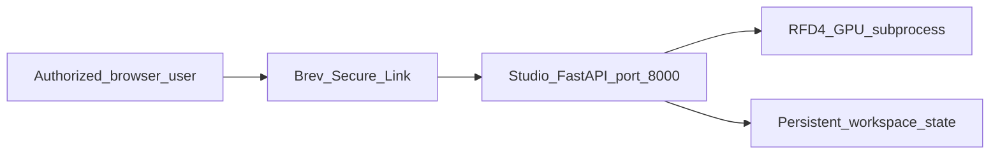

# Authenticated Brev Studio pilot plan

## Goal

Deploy the complete AtomWorks Studio + RFD4 service on one warm Brev GPU
instance and expose it through a Brev Secure Link. Authorized lab members and
collaborators can open the HTTPS URL from anywhere, create annotated CIFs, and
submit serialized RFD4 jobs.

This pilot does not split the static frontend from the API and does not
dispatch across multiple GPU instances. Studio, its session state, and RFD4
run on the same machine.



## Current repository state

- The implemented Brev deployment is in `deploy/brev/`.
- `launchable-setup.sh` installs the toolchain and restartable service.
- `start.sh` runs Studio, serializes RFD4 jobs, and optionally starts the warm
  AF3 daemon.
- `scripts/accept_brev.py` exercises CIF editing, one-step generation, output
  loading, and optional AF3 search.
- Current ownership, deployment state, acceptance evidence, and operator
  commands are recorded in [PILOT_STATUS.md](PILOT_STATUS.md).

## Security and operating boundary

- Keep Brev authentication enabled on the Secure Link.
- Invite or grant access only to intended users. Do not expose anonymous paid
  GPU submission.
- Studio capability IDs protect individual documents but are not user identity,
  quotas, or a billing boundary.
- The pilot runs one RFD4 job at a time with
  `ANNOTATION_STUDIO_MAX_ACTIVE_JOBS=1`.
- Stop the instance during long idle periods. Workspace data survives `stop`
  and `start`, but not instance deletion.
- Never commit Brev credentials, GitHub tokens, checkpoint credentials, AF3
  weights, or runtime secret files.

## Phase 1: authenticate and inspect existing compute

Run on the authenticated machine:

```bash
git clone git@github.com:baker-laboratory/atomworks-studio.git
cd atomworks-studio
git switch kdidi/brev-secure-link-pilot

brev --version
brev login
brev org ls
brev org set
brev ls
```

Use an existing suitable Brev GPU instance when available. Do not create new
paid compute until the active organization, GPU type, region, hourly cost, and
intended owner have been confirmed.

The selected instance needs:

- VM mode with Docker and systemd;
- enough VRAM for the intended RFD4 input sizes;
- persistent workspace storage;
- one GPU for RFD4, or two GPUs when OF3 refolding is enabled;
- SSH access to the private Studio and RFD4 repositories.

## Phase 2: prepare persistent data

On the Brev instance, keep durable files below `/home/ubuntu/workspace`:

```text
/home/ubuntu/workspace/atomworks-studio/
/home/ubuntu/workspace/RFD4-Proteina-dev/
/home/ubuntu/workspace/rfd4-data/
/home/ubuntu/workspace/rfd4-annotation-studio/
```

Use the RFD4 revision pinned by Studio's
`external/RFD4-Proteina-dev` submodule. A separate checkout is supported only
when it contains the minimum revision enforced by `launchable-setup.sh`.

Required environment values:

```bash
export RFPROTEINA_ROOT=/home/ubuntu/workspace/RFD4-Proteina-dev
export ANNOTATION_STUDIO_RFD4_ROOT="$RFPROTEINA_ROOT"
export DATA_PATH=/home/ubuntu/workspace/rfd4-data
export BREV_RFD4_STATE_DIR=/home/ubuntu/workspace/rfd4-annotation-studio
# Reserve GPU 1 for RFD4 generation. The OF3 daemon below uses GPU 0.
export CUDA_VISIBLE_DEVICES=1
```

Download and validate the exact checkpoints selected by pinned RFD4:

```bash
bash "$RFPROTEINA_ROOT/scripts/download_example_data.sh" "$DATA_PATH"
uv run python scripts/check_rfd4_assets.py \
  --rfd4-root "$RFPROTEINA_ROOT" --check-bucket
```

For a two-GPU OF3 deployment, configure the RFD4 daemon's canonical variables:

```bash
export AF3_IMAGE="$DATA_PATH/af3/apptainer_images/af3-open-36fad16.sif"
export AF3_MODEL_DIR="$DATA_PATH/af3/af3_weights/of3"
export AF3_JAX_CACHE_DIR="$DATA_PATH/af3/jax_cache"
export ANNOTATION_STUDIO_REFOLDING_ORACLES=of3
# Keep OF3 on GPU 0 and RFD4 generation on GPU 1. This also works with the
# pinned legacy launcher, whose rank 0 maps to physical GPU 0.
export AF3_GPU_DEVICES=0
```

Leave all refolding variables unset for the initial one-GPU RFD4 pilot.

## Phase 3: deploy the service

Preferred route: create a Brev Launchable in VM mode:

1. Select the AtomWorks Studio repository.
2. Use `deploy/brev/launchable-setup.sh` as the setup script.
3. Disable Jupyter.
4. Add an authenticated Secure Link named `studio` for port `8000`.
5. Supply `DATA_PATH` and `BREV_RFD4_STATE_DIR` as launch parameters. Set
   `RFPROTEINA_ROOT` only when overriding the bundled RFD4 submodule.
6. Select the approved GPU profile and persistent disk size.
7. Create or apply the Launchable to the selected instance.

For an existing instance without a Launchable:

```bash
cd /home/ubuntu/workspace/atomworks-studio
bash deploy/brev/launchable-setup.sh
```

The setup script builds the web assets and RFD4 runtime, installs a systemd
service, starts Studio, and waits for `/api/health`.

Inspect failures with:

```bash
sudo systemctl status rfd4-annotation-studio
sudo journalctl -u rfd4-annotation-studio -n 200 --no-pager
curl --fail http://127.0.0.1:8000/api/health
curl --fail http://127.0.0.1:8000/api/ready
```

The health response must report:

```json
{
  "status": "ok",
  "session_store": "persistent",
  "design_jobs": "enabled"
}
```

## Phase 4: create and verify the webpage URL

In the Brev instance's **Access** tab:

1. Add a Secure Link named `studio`.
2. Set its target port to `8000`.
3. Keep browser authentication enabled.
4. Copy the generated HTTPS URL.
5. Test the URL in a private browser session to verify that unauthenticated
   users are redirected to Brev login.

Record the generated URL in deployment notes, not in a secret file. This URL
is the pilot webpage address.

Run API and GPU acceptance:

```bash
export ANNOTATION_STUDIO_URL='https://REPLACE_WITH_BREV_SECURE_LINK'
mkdir -p "$BREV_RFD4_STATE_DIR/acceptance"
export ATOMWORKS_STUDIO_ACCEPTANCE_ARTIFACT="$BREV_RFD4_STATE_DIR/acceptance/brev.json"
export ATOMWORKS_STUDIO_ACCEPT_AF3=0
python scripts/accept_brev.py
```

Then verify manually:

1. Open both `?viewer=molstar` and `?viewer=patinae`.
2. Upload a CIF.
3. Apply RFD4 annotations.
4. Download and reopen the annotated CIF.
5. Submit one one-step design.
6. Open the generated output in Studio.
7. Restart the service and confirm session snapshots remain available.

## Phase 5: collaborator access and operations

- Add intended collaborators to the Brev organization or use Brev's supported
  access-sharing workflow.
- Confirm each collaborator can authenticate to the Secure Link without SSH
  access to the VM.
- Keep one operator responsible for instance start/stop and cost monitoring.
- Monitor disk space, job failures, and service health.
- Stop rather than delete the instance when idle:

```bash
brev stop <instance-name>
brev start <instance-name>
```

After restart, confirm the systemd service and Secure Link return to healthy
operation.

## Completion criteria

- A stable Brev HTTPS URL is recorded.
- Authentication is required from outside the organization.
- Mol* and Patinae both load.
- Annotated CIF round-trip succeeds.
- One real RFD4 design completes and opens in the browser.
- The service survives restart and preserves persistent state.
- AF3 remains disabled until a separate two-GPU acceptance run passes.
- Instance ownership and stop/start responsibility are documented.

## Future work, not required for the pilot

- A custom domain can front the same service through Cloudflare Tunnel and
  Cloudflare Access.
- Multiple Brev/CoreWeave workers require a persistent queue, object storage,
  identity-aware quotas, retries, heartbeats, cancellation, and cost
  attribution.
- Brev Registered Compute is suitable only for persistent Linux machines with
  sudo/systemd. It does not manage Slurm allocation lifecycle and should not be
  installed independently on ephemeral CoreWeave worker nodes.
