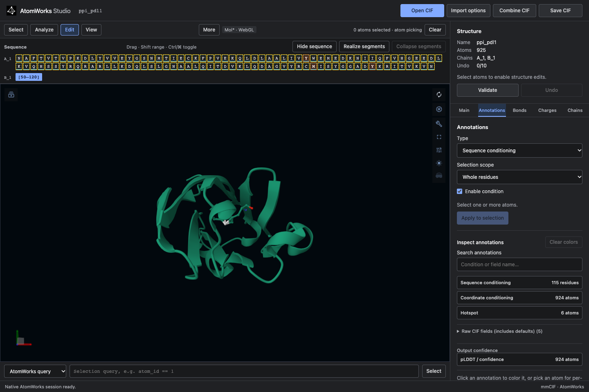
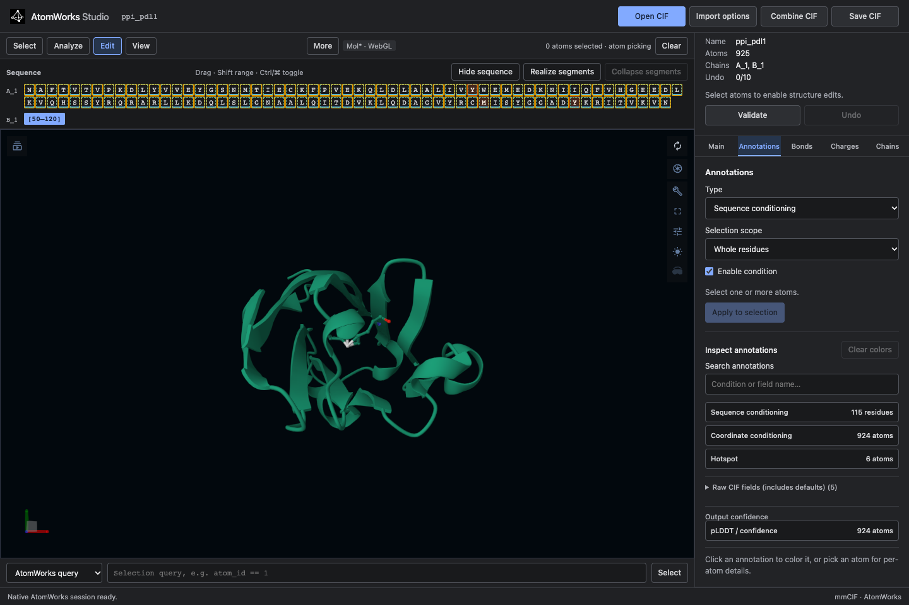
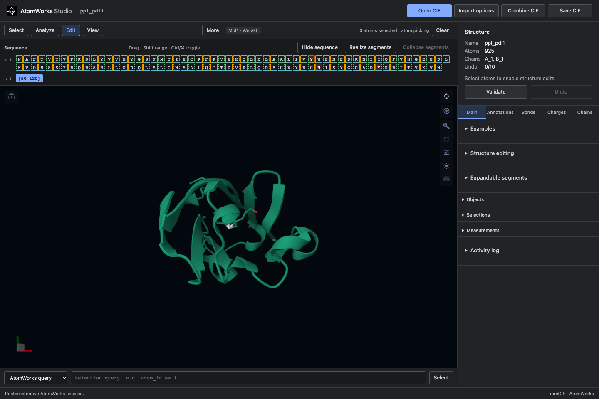

# Browser guide

The website is the complete AtomWorks Studio editor. It runs locally or from a
shared deployment, keeps the authoritative annotated CIF in the Studio API,
and supports two independent molecular renderers.



## Start the editor

With installed wheels, run `atomworks-studio`. See [installation](INSTALLATION.md).
From a source checkout:

```bash
make bootstrap
make run
```

Open <http://127.0.0.1:8000/>. It uses **Patinae/WebGPU by default**; if the
browser has no WebGPU support it automatically falls back to Mol*/WebGL. Pin a
renderer explicitly with a query parameter:

- <http://127.0.0.1:8000/?viewer=patinae> — Patinae using WebGPU
- <http://127.0.0.1:8000/?viewer=molstar> — Mol* using WebGL

Patinae and Mol* implement the same Studio actions. An explicit renderer choice is retained for later visits. A fatal Patinae
runtime failure still switches to Mol* to preserve the open document.

## Load a structure

Choose **Open CIF** and select a `.cif` or `.mmcif` file. **Import options**
controls:

- **Preset** — annotated CIF or RCSB preparation
- **Assembly** — one assembly, the first assembly, all assemblies, or asymmetric
  unit
- **Model** — one model or all models
- **Hydrogens** — keep or remove
- **Remove waters** — optional water filtering

Use **Combine CIF** to merge another file into the active document. The
**Edit** panel includes PPI, MCSA enzyme, and DISCO-style
small-molecule examples that can be loaded without locating a file manually.

The fixtures are described in
[examples/README.md](https://github.com/baker-laboratory/atomworks-studio/blob/main/examples/README.md).

## Navigate and select

The sequence strip stays synchronized with the 3D view. Click a residue to
select it, use Ctrl/Cmd-click to toggle residues, and Shift-click to extend a
range. Choose atom, residue, or chain picking from **Select**.

The command field supports:

- **AtomWorks query** selects atoms with expressions such as `atom_id == 1` or
  `has_bonds()`, in either renderer. Selection paths use the same mode:
  `sel('*/*/*/CA')` selects alpha carbons.
- **PyMOL commands** selects and styles atoms through Patinae; for example,
  `select sele, name CA`, then `show spheres, sele`.
  It accepts supported PyMOL-style commands, but is not a PyMOL or Python console.
  Commands that would change document data are blocked; use the editing panels.

The action reads **Select** for queries and **Run** for viewer commands. The
field shows an example for the selected syntax.

See the [selection reference](SELECTIONS.md) for lists, ranges, chain instances,
and the distinction from native PyMOL syntax.

Selection, camera, representations, measurements, and annotation overlays are
replayed when switching renderers. Choose a renderer under **More**.
The inspector stays open while using viewer menus.

## Edit an annotated CIF

The **Edit** inspector uses the same **Main**, **Annotations**, **Bonds**,
**Charges**, and **Chains** tabs as PyMOL. Main contains examples, structure edits,
and expandable segments. Tab names and order come from the shared Python package.
The browser and VS Code use the same UI code. Select atoms or residues, choose an operation,
then apply it. **Undo** reverts the last document edit.

Conditions are stored in the CIF. A successful condition edit clears the
selection, matching PyMOL; failed or cancelled edits keep it. Click a row under
**Inspect annotations** to color its atoms, or pick an atom for its values.
**Raw CIF fields** includes stored defaults as well as active constraints.



## Protonate a structure

Open **Edit → Charges**, set the pH, and choose **Protonate structure**. The
default is 7.4. This updates hydrogens and formal charges across the whole
structure using AtomWorks 3's experimental protonation API. It does not require
a model runtime. Bonds and chemical identity must be present for meaningful
assignment; unsupported geometry reports an error without changing the document.

Existing heavy-atom annotations are retained. AtomWorks may retain or replace
existing hydrogens and adds their bonds. Missing coordinates and special chemical
states follow AtomWorks' rules; inspect the result before using it as model input.
The selection is cleared because atom rows can move. **Undo** restores the
previous structure, and **Save CIF** includes the protonated result.

## Analyze a structure

Use **Analyze** to add distance, angle, or dihedral measurements and to inspect
hydrogen bonds, hydrophobic contacts, pi interactions, salt bridges, halogen
bonds, and metal coordination. Interaction results are selectable and render
as overlays in either viewer.

Use **Style** and **View** for representations, coloring, backgrounds, camera
orientation, and fullscreen behavior. Patinae additionally accepts native
viewer commands.

## Save and round-trip

Choose **Save CIF** to validate and export the authoritative AtomWorks document,
including stored molecular annotations, bonds, and charges. Export rebuilds the
CIF from that document; unrelated top-level categories and original text formatting
are not retained. Keep the original file if you need that metadata.

The downloaded file can be opened in:

- another Studio session
- the [PyMOL plugin](PYMOL.md)
- RFD4-Proteina as a native annotated-CIF input

## Install as a PWA

Studio publishes a web app manifest and a shell-only service worker. On
`localhost` or an HTTPS deployment, use the browser's **Install app** action to
open Studio as a standalone application. The service worker caches the
application shell but never caches API responses, sessions, CIFs, or model
results.

## Use inside VS Code or Cursor

The extension embeds the same service and UI:



Install and configure it with the
[VS Code/Cursor extension guide](VSCODE.md). Remote editor
sessions use VS Code's external-URI forwarding; the server must allow
`vscode-webview:` in `ANNOTATION_STUDIO_FRAME_ANCESTORS`.

## Troubleshooting

- **Blank or unsupported renderer** — switch explicitly to Mol* if the browser
  lacks WebGPU, or to Patinae if WebGL is unavailable.
- **PyMOL changes disappeared** — direct PyMOL edits are not automatically
  authoritative. Follow the round-trip guidance in the
  [PyMOL guide](PYMOL.md).
- **Embedded view refused** — add the exact parent origin to
  `ANNOTATION_STUDIO_FRAME_ANCESTORS`.

If Patinae stops while rendering, Studio switches to Mol* and keeps the open document,
annotations and Undo history. This can occur with software WebGPU drivers. The renderer
label and activity log show the switch.
