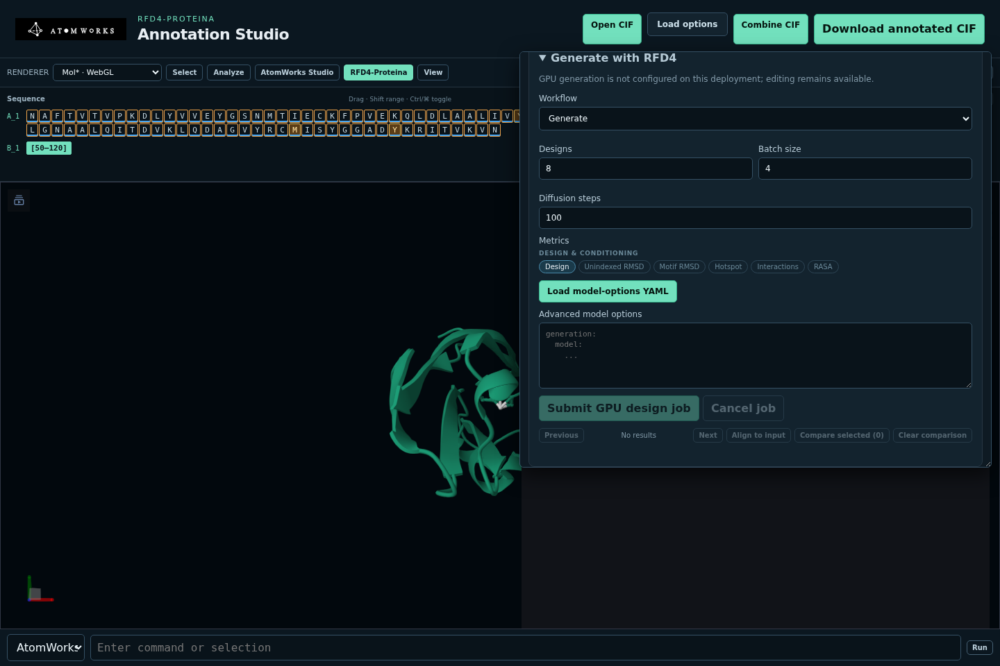
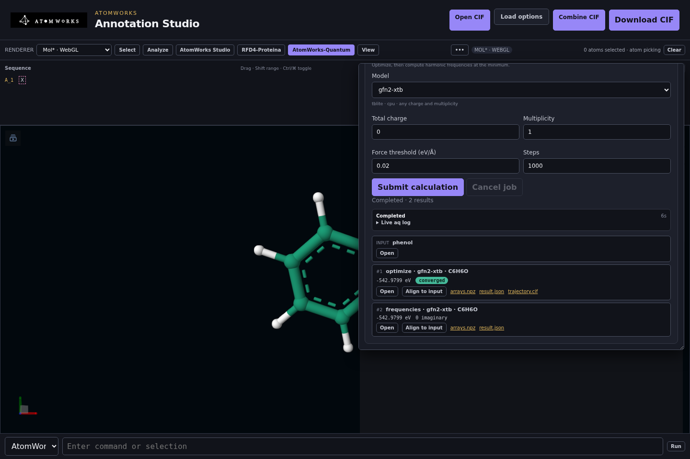

# Using the AtomWorks Studio website

The website is the complete AtomWorks Studio editor. It runs locally or from a
shared deployment, keeps the authoritative annotated CIF in the Studio API,
and supports two independent molecular renderers.


## Start the editor

From a source checkout:

```bash
make bootstrap
make run
```

Open <http://127.0.0.1:8000/>. It uses **Patinae/WebGPU by default**; if the
browser has no WebGPU support it automatically falls back to Mol*/WebGL. Pin a
renderer explicitly with a query parameter:

- <http://127.0.0.1:8000/?viewer=patinae> — Patinae using WebGPU
- <http://127.0.0.1:8000/?viewer=molstar> — Mol* using WebGL

Patinae and Mol* implement the same Studio actions. When a renderer is pinned
explicitly it is never swapped automatically. A renderer choice is retained for
later visits.

## Load a structure

Choose **Open CIF** and select a `.cif` or `.mmcif` file. **Load options**
controls:

- **Preset** — annotated CIF or RCSB preparation
- **Assembly** — one assembly, the first assembly, all assemblies, or asymmetric
  unit
- **Model** — one model or all models
- **Hydrogens** — keep or remove
- **Remove waters** — optional water filtering

Use **Combine CIF** to merge another file into the active document. The
**RFD4-Proteina** panel also includes PPI, MCSA enzyme, and DISCO-style
small-molecule examples that can be loaded without locating a file manually.



The fixtures and their model presets are described in
[examples/README.md](../examples/README.md).

## Navigate and select

The sequence strip stays synchronized with the 3D view. Click a residue to
select it, use Ctrl/Cmd-click to toggle residues, and Shift-click to extend a
range. Choose atom, residue, or chain picking from **Select**.

The command field supports:

- **Patinae** commands when the Patinae renderer is active
- **AtomWorks** expressions such as `(atom_id == 1) | (atom_id == 2)`
- **Path** selection syntax

Selection, camera, representations, measurements, and annotation overlays are
replayed when switching renderers.

## Edit an annotated CIF

Open **AtomWorks Studio** in the toolbar. The panel exposes the mutation and
annotation operations supported by the active provider:

- inspect, apply, and clear conditions
- set or adjust formal charges
- add, remove, and infer bonds
- assign chain identifiers
- insert, realize, or collapse expandable segments
- delete selected atoms, optionally closing residue gaps
- undo document edits


Conditions are stored in the CIF, not in browser-only state. The API applies
the same AtomWorks mutation primitives used by the PyMOL plugin.

Applying or removing a condition clears the editing selection after success,
matching the native plugin. Failed or cancelled edits keep the selection.
Click an annotation row to inspect its active atoms; this clears unrelated
selection markers. The collapsed **Raw CIF fields (includes defaults)** section
is for inspecting serialized values, including unset/default entries, and is
separate from the active-constraint summaries.

## Analyze a design

Use **Analyze** to add distance, angle, or dihedral measurements and to inspect
hydrogen bonds, hydrophobic contacts, pi interactions, salt bridges, halogen
bonds, and metal coordination. Interaction results are selectable and render
as overlays in either viewer.

Use **Style** and **View** for representations, coloring, backgrounds, camera
orientation, and fullscreen behavior. Patinae additionally accepts native
viewer commands.

## Save and round-trip

Choose **Download CIF** to export the authoritative document. Unknown
CIF categories are preserved by the lossless WASM inspector, so a document can
be opened, inspected, edited, and downloaded without reducing it to the subset
understood by the renderer.

The downloaded file can be opened in:

- another Studio session
- the [PyMOL plugin](../packages/pymol-plugin/README.md)
- RFD4-Proteina as a native annotated-CIF input

## Generate with RFD4

The **RFD4-Proteina** panel is always discoverable, but submission controls are
enabled only when a design provider is configured. A CPU-only Studio reports
that generation is not configured without treating the editor as failed.

With the local GPU launcher or a Brev deployment, the panel can:

- start from **Fast screen** for eight short designs with inline geometry and
  interface checks, or **Confidence-ranked binder** for a larger screen with
  OpenFold3 (OF3) refolding when that capability is configured;
- show the selected design count, diffusion steps, batches, and whether model
  refolding will add GPU time before submission;
- choose generation or reward-guided search
- select model metrics, choose the available OF3/AF3 runtime, and select
  refolding tags
- set replicate and search parameters
- submit, monitor, and cancel a job
- show phases, elapsed time, and live logs
- cycle, align, and compare returned designs
- download generated and refolded CIFs

The recipes are intentionally editable: use one to obtain a sensible first
submission, then open **Design settings** only for the metrics, search, and
sampling controls that need changing. **Advanced model options (YAML)** is
collapsed because it is for reviewed, data-only overrides rather than routine
design setup. OF3 confidence metrics are useful for ranking but materially
slower; avoid them for exploratory screens when inline checks answer the
question.

While a job is active Studio polls quickly enough to keep the phase and log
current, then backs off for queued and background-browser jobs. Leaving a tab
open therefore does not create a high-frequency control-plane load.

Use the [local GPU guide](../deploy/local/README.md) or
[Brev guide](../deploy/brev/README.md) to enable these controls.

## Run quantum calculations

When the API runs the AtomWorks-Quantum provider (configured as described in
[providers/quantum/README.md](../providers/quantum/README.md)), the toolbar
shows an **AtomWorks-Quantum** tab. It runs atomworks-quantum (aq) on the
structure open in the editor. Without the provider the tab is hidden.

- Choose a calculation: **Single point**, **Optimize**, **Optimize +
  frequencies**, **Transition state search** (needs aq's `ts` extra), or
  **Molecular dynamics**.
- Choose an installed model, the structure's total charge as an integer, and
  the spin multiplicity. The note under the model says which charges and
  multiplicities it accepts. The panel does not offer aq's `formal` charge: it
  needs hydrogen annotations that structures exported from Studio do not carry,
  so aq would first have to protonate the structure. Optimizations and
  transition-state searches take a force threshold in eV/Å and a step limit;
  molecular dynamics takes its number of steps. Both start at aq's defaults for
  the chosen calculation.
- Submit, follow the current stage, the elapsed time and the aq log, and cancel
  if needed; a cancelled job still lists the stages that finished. The job keeps
  the structure as it was when you submitted it.
- Each finished stage is listed with its energy in eV, whether it converged,
  and its number of imaginary frequencies. **Open** makes the stage's structure
  the active document, **Align to input** superimposes it on the submitted
  structure first, and the file links download its results, such as
  `result.json` and `trajectory.cif`.



## Install as a PWA

Studio publishes a web app manifest and a shell-only service worker. On
`localhost` or an HTTPS deployment, use the browser's **Install app** action to
open Studio as a standalone application. The service worker caches the
application shell but never caches API responses, sessions, CIFs, or model
results.

## Use inside VS Code or Cursor

The extension embeds the same service and UI:


Install and configure it with the
[VS Code/Cursor extension guide](../packages/vscode/README.md). Remote editor
sessions use VS Code's external-URI forwarding; the server must allow
`vscode-webview:` in `ANNOTATION_STUDIO_FRAME_ANCESTORS`.

## Troubleshooting

- **Blank or unsupported renderer** — switch explicitly to Mol* if the browser
  lacks WebGPU, or to Patinae if WebGL is unavailable.
- **Generation disabled** — the editor is healthy; configure an RFD4 provider
  only when GPU generation is required.
- **PyMOL changes disappeared** — direct PyMOL edits are not automatically
  authoritative. Follow the round-trip guidance in the
  [PyMOL guide](../packages/pymol-plugin/README.md).
- **Embedded view refused** — add the exact parent origin to
  `ANNOTATION_STUDIO_FRAME_ANCESTORS`.
