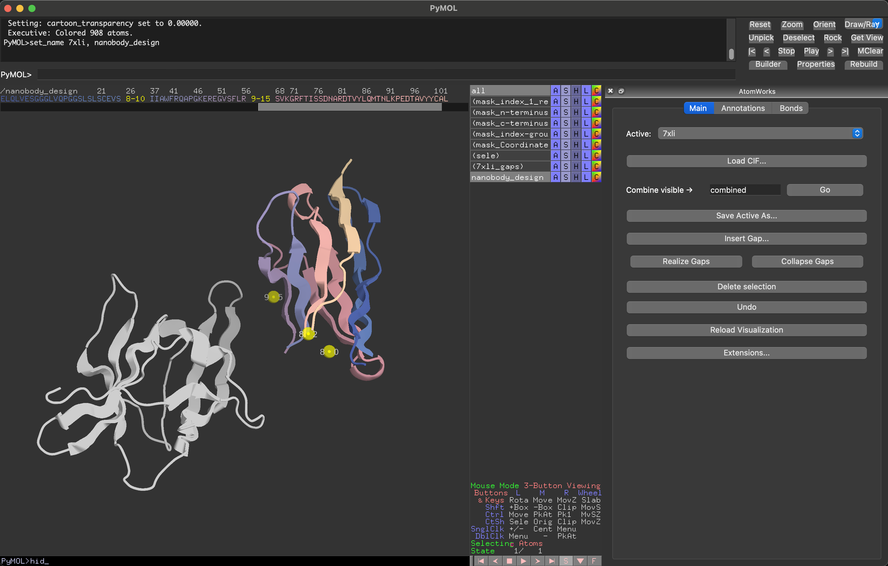
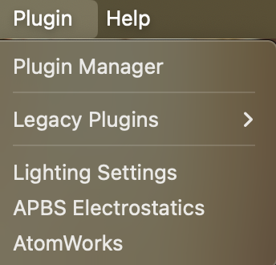
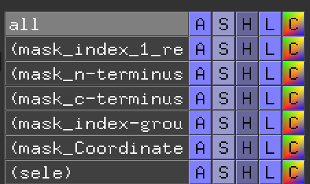

# AtomWorks Design Studio

## Overview: A New Way to Design Proteins



The AtomWorks Design Studio is a PyMOL plugin that replaces the traditional JSON/YAML contig-based protein design workflow with a fully visual one. Instead of writing config files to describe what you want a model to do, you build your design task directly in PyMOL: load a real structure, manipulate it, annotate exactly what you want the model to do, and save. The result is an **annotated CIF file** that new models like the latent diffusion model read natively — no intermediate JSON or YAML is ever written or converted.

**Annotated CIF files** are standard mmCIF files extended with AtomWorks condition blocks. All design intent is stored per-atom and per-residue directly in the file: sequence conditioning, coordinate conditioning, distance restraints, hydrogen bond conditioning, unindexing, and more. This is the single input format that goes directly into the model.

**The workflow shift is significant.** Previously, you described a design task abstractly — chain lengths, contig strings, residue ranges — in a text config. Now, you visualize exactly what you want to design in 3D, annotate it interactively, and hand the model the CIF. What you see in PyMOL is what goes into the model.

---

## The Ground Truth AtomArray: Why It Matters

The plugin maintains an `AtomArrayPlus` in memory as the **authoritative representation** of each loaded structure. This is what gets saved and what the model reads. PyMOL is purely a viewer.

Operations performed via the AtomWorks panel — loading, deleting atoms, inserting expandable segments, editing annotations — are applied to the ground truth array and reflected in PyMOL. Operations performed directly in PyMOL — GUI mutations, coordinate dragging, PyMOL's own selection-based edits — are **not necessarily** reflected in the array and may be silently lost on the next reload.

**If you are unsure whether a change was captured**, press **Reload Visualization**. This re-renders the PyMOL view from the ground truth array. What you see after a reload is exactly what the model will receive.

**General rule: only use AtomWorks plugin methods to load, modify, annotate, and save structures.** Anything done outside the plugin may not be captured.

### Round-Tripping for Unsupported Edits

For advanced PyMOL operations that are not yet supported natively — mutations, coordinate manipulation, rotamer changes — use this workflow:

1. Make the changes in PyMOL using its built-in tools
2. Save the result as a CIF using PyMOL's native File → Save Molecule
3. Reload that CIF using AtomWorks **Load CIF**
4. Re-apply any annotations needed

This will be streamlined in a future version with native support for more PyMOL edit operations.

---

## Setup

PyMOL open-source is not reliably pip-installable. Create the supplied conda
environment, then install this package into that same environment:

```bash
conda env create -f pymol_env.yaml
conda activate atomworks
python -m pip install .
```

For development, install the test extra in editable mode:

```bash
python -m pip install -e ".[test]"
```

The wheel pins and installs `atomworks[ml]`, which remains the authority for
all mutation, annotation, and CIF IO behavior. The plugin does not carry local
copies of those primitives.

### Start PyMOL

The package publishes the standard `pymol.plugins` entry point, so a PyMOL
installation that discovers Python package entry points loads it automatically.
Start PyMOL from the environment where the package was installed:

```bash
pymol
```

For older PyMOL builds that do not discover entry points, add this fallback to
`~/.pymolrc` using the installed file path reported by
`python -c "import atomworks.pymol_plugin as p; print(p.__file__)"`:

```text
run /path/to/site-packages/atomworks/pymol_plugin/__init__.py
```

### Open the Panel



Start PyMOL with the conda environment active, then open the panel via:

- **Menu**: Plugin → AtomWorks
- **Console**: `aw_load` (also loads a file directly)

The panel has three tabs: **Main**, **Annotations**, and **Bonds**.

---

## Extensions: Loading Model-Specific Editors

Different models define their own condition types and ship their own annotation editors as extensions. Extensions are registered separately from AtomWorks core and persist across PyMOL sessions.

**The `proteinfoundation` extension** registers editors for conditions used by the protein foundation model family (sequence, coordinate, distance, hydrogen bond conditioning, etc.). Without it, the Annotations tab only shows base AtomWorks annotations.

Install model-specific extension packages into the same environment as PyMOL.
Extensions are managed from **Main tab → Extensions...** and persist in
`~/.atomworks/pymol_extensions`.

Any model package can ship an extension by exposing a `register()` function in the target module. This is how new models add their conditions to the plugin without requiring changes to AtomWorks itself.

---

## Basic Workflow

### Loading a Structure

Always use **Load CIF** in the Main tab rather than PyMOL's File → Open. This registers the structure with the plugin and builds the ground truth array.

Parse options available in the load dialog:

| Option | Default | Description |
|---|---|---|
| Load standard annotations | On | Load AtomWorks annotations saved in the CIF (design CIFs) |
| Add missing atoms | Off | Rebuild missing sidechain/hydrogen atoms from the CCD |
| Remove waters | On | Strip water molecules on load |

The plugin always loads the first biological assembly when one is present.

### Saving a Structure

Always use **Save Active As** in the Main tab. This writes a full annotated CIF with all conditions embedded — the file is ready to pass directly to the model.

Do not use PyMOL's native save for structures you intend to use as model inputs; it does not write AtomWorks annotations.

### Selecting the Active Object

The **Active** dropdown at the top of the Main tab shows which object all panel operations apply to. If multiple structures are loaded, use this to switch between them. **When adding annotations, make sure the active object is the one you want to add annotations to!** You can also switch from the console:

```
aw_set_active my_object
```

### Deleting Atoms

Make a selection in the PyMOL viewport, then click **Delete selection** in the Main tab. This removes the selected atoms from the ground truth array and reloads the view.

### Combining Structures

**Combine visible** merges all currently visible AtomWorks-managed objects into a single structure under a new name. Chain conflicts are resolved automatically. Source objects are hidden after combining.

This is useful for assembling a complex from separately loaded chains before annotating.

### Undo

The **Undo** button reverts the last edit to the active object. Up to 10 undo levels are maintained per object. Note these undo actions are only for AtomWorks operations (anything done in the AtomWorks Design Studio panels).

---

## Expandable Segments

Expandable segments represent **variable-length designed segments** — the visual equivalent of writing `"10-15"` in an RFD3 contig string. Rather than specifying a length range in a config file, you insert an expandable segment directly into the structure. The model samples a concrete length at runtime.

This means your input CIF can contain genuine structural uncertainty: a binder scaffold with an expandable segment between two helices, for example, tells the model that it should design a linker of some sampled length rather than a fixed sequence.

### Expandable Segment Operations

| Button | Description |
|---|---|
| **Insert Expandable Segment...** | Insert a segment before or after the current selection, or as a new standalone chain |
| **Realize Segments** | Replace segment sentinels with actual placeholder residues (for downstream processing) |
| **Collapse Segments** | Merge consecutive segment residues back into a single sentinel |

When inserting an expandable segment, you specify:
- **Min / Max length**: the range the model will sample from (e.g. min 10, max 15 → `"10-15"`)
- **Insert before / after**: relative to the current selection
- **New chain**: insert as an independent chain rather than within an existing one

**Note on realizing segments:** If you save an annotated CIF with segments realized, the models will NOT sample at run time as you have effectively already sampled from your ranges. Save annotated CIFs with segments collapsed if you want the model to sample from the ranges at run time.

---

## Annotations

The **Annotations** tab is where design intent is specified. Each annotation corresponds to a condition that the model reads from the CIF. Select an annotation type from the list on the left; the editor for that annotation appears on the right. Changes are written immediately to the ground truth array and saved into the CIF when you use Save Active As.

Annotations available depend on which extensions are registered and more may be added in the future.

**To mark residues as unindexed, simply toggle off the Index condition (everything defaults to indexed). That's it!**

Once you have conditions applied to your atom array, you will see PyMOL selections for each condition. Besides certain visual cues (distance conditions visualized as PyMOL distances, etc.) these selections indicate which atoms have which conditions. The names of the conditions generally have the format:

`condition_{condition_name}_{n_body}_{level}_{object_name}`

For example, the index condition has a selection called: `mask_index_1_residue_6lyz` for the object `6lyz`.



---

## Bonds

The **Bonds** tab allows manual editing of the bond graph for cases where automatic inference is insufficient — non-standard linkages, metal coordination, unusual ligands.

**WARNING**: `.pdb` files do not necessarily maintain all the bonds you think they do! Always double check which bonds are actually encoded and add/remove bonds as necessary! This is especially important for complicated bond graphs such as ligands, non-canonicals, post-translational modifications, etc.

- **Pick atoms**: click Select Atom 1 / Select Atom 2, then click atoms in the PyMOL viewport
- **Add / Remove bond**: apply or remove a bond of the chosen type between the two picked atoms
- **Bonds table**: shows all bonds involving the current PyMOL selection; individual bonds can be deleted from here
- **Infer Bonds from CCD**: replaces all bonds using CCD template matching (requires `CCD_MIRROR_PATH` to be set)

---

## Console Commands

All panel operations are also available as `aw_*` console commands for scripting:

| Command | Description |
|---|---|
| `aw_load <path> [obj_name]` | Load a CIF into AtomWorks |
| `aw_save <path> [obj_name]` | Save the active (or named) object as annotated CIF |
| `aw_delete [selection] [obj_name]` | Delete selection from the active object |
| `aw_insert_segment [selection] [min] [max] [before]` | Insert an expandable segment at the selection |
| `aw_undo [obj_name]` | Undo the last edit |
| `aw_combine_visible [new_name]` | Combine all visible tracked objects |
| `aw_set_active <obj_name>` | Set the active object |

---

## Updating AtomWorks Design Studio

From this package directory:

```bash
git pull
python -m pip install .
```

Then restart PyMOL.

## Limitations and Future Work

- **Coordinate editing, mutations, and rotamer changes** made directly in PyMOL are not yet natively captured by the plugin. Use the round-trip workflow described above (edit in PyMOL → save CIF → reload with Load CIF) until native support is added.
- **Only CIF files** are fully supported for load/save. PDB files can be viewed in PyMOL alongside AtomWorks objects but will not be registered with the plugin.
- Tighter PyMOL integration — including automatic capture of PyMOL-side edits — is planned for a future release.

## Feature Requests and Bug Reports

AtomWorks Design Studio is in Beta, so we greatly appreciate your patience as early software users. That said, if you run into any bugs, unexpected/unintuitive behavior, or you come up with some brilliant new feature ideas, please reach out to Max or the latent model team!
