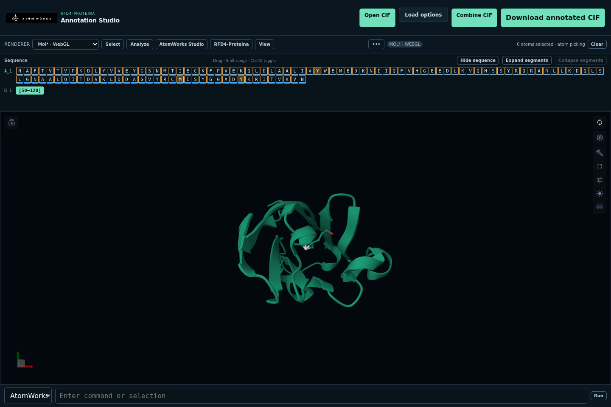

# AtomWorks Annotation Studio for VS Code

The extension opens the same AtomWorks Studio service used by the website. It
does not copy CIF, session, credential, or model state into the extension host.



## Install

**Download the latest `.vsix`** (rebuilt from `main` on every push by CI):

- <https://github.com/baker-laboratory/atomworks-studio-dev/releases/download/vscode-latest/atomworks-annotation-studio.vsix>

Versioned builds are attached to each [`v*` release](https://github.com/baker-laboratory/atomworks-studio-dev/releases),
and you can always build it yourself with `pnpm --dir packages/vscode package`.

Then install it in VS Code or Cursor:

```bash
code --install-extension atomworks-annotation-studio.vsix --force
# or
cursor --install-extension atomworks-annotation-studio.vsix --force
```

…or from the GUI: open the **Extensions** panel, click the `···` menu →
**Install from VSIX…**, select the file, and reload the window.

> The repository is private, so the release link requires a GitHub account with
> access. A public Marketplace / Open VSX listing can be enabled by registering
> the `rfd4-proteina-team` publisher and setting a `VSCE_PAT` CI secret.

## Use

The extension is a thin client: it renders the shared Studio service in a VS
Code webview and does no editing on its own, so it needs a **reachable Studio
server**. Two ways to get one:

- **Hosted deployment** — use the URL of a running Studio service (for example a
  Brev GPU deployment). Nothing to install locally.
- **Local service** — from the repo root run `make run` and use
  `http://127.0.0.1:8000`. The CPU service is enough to edit and round-trip
  CIFs; RFD4/GPU is only needed for design jobs.

Then:

1. Run **AtomWorks: Configure Annotation Studio Server** from the Command
   Palette and enter the service URL.
2. Run **AtomWorks: Open Annotation Studio**. It opens with Patinae/WebGPU by
   default — no renderer prompt.

Switch to Mol*/WebGL (or back to Patinae) at any time with **AtomWorks: Select
Annotation Studio Renderer**. Mol* is used only if you select it; neither
renderer silently falls back to the other.

> If the webview is blank, the server is refusing to be embedded: set
> `ANNOTATION_STUDIO_FRAME_ANCESTORS="'self' vscode-webview://* vscode-webview:"`
> on the service (the Brev deployment sets this by default).

Remote and Codespaces sessions use VS Code's external-URI forwarding. The
configured service must allow `vscode-webview:` in
`ANNOTATION_STUDIO_FRAME_ANCESTORS`.

For browser workflows, see the [website guide](../../docs/WEB.md). For
compiling, packaging, reinstalling, and smoke testing the extension, see the
[development guide](../../docs/DEVELOPMENT.md#vs-code-and-cursor).

## Troubleshooting

- **Service not reachable** — verify `/api/health` on the configured URL and
  use the configuration command to correct it.
- **Webview refused to load** — approve `vscode-webview:` in the service frame
  ancestors policy.
- **Old extension still loaded** — uninstall
  `rfd4-proteina-team.atomworks-annotation-studio`, reinstall the matching
  `.vsix` with `--force`, and reload the editor window.
